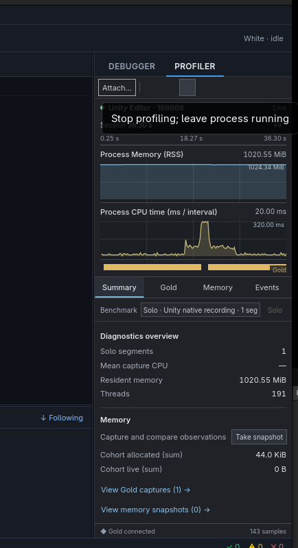
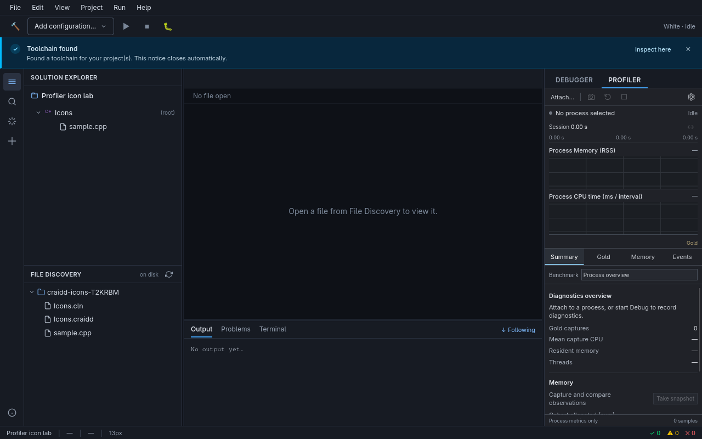
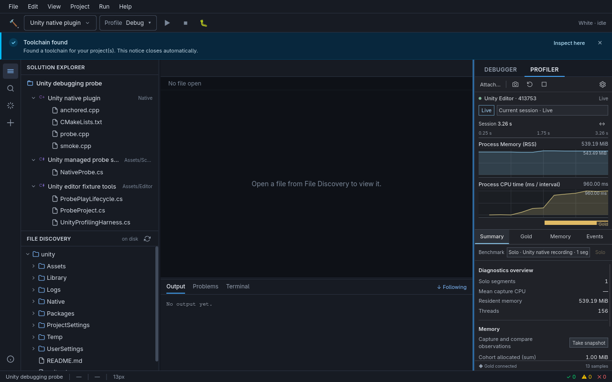
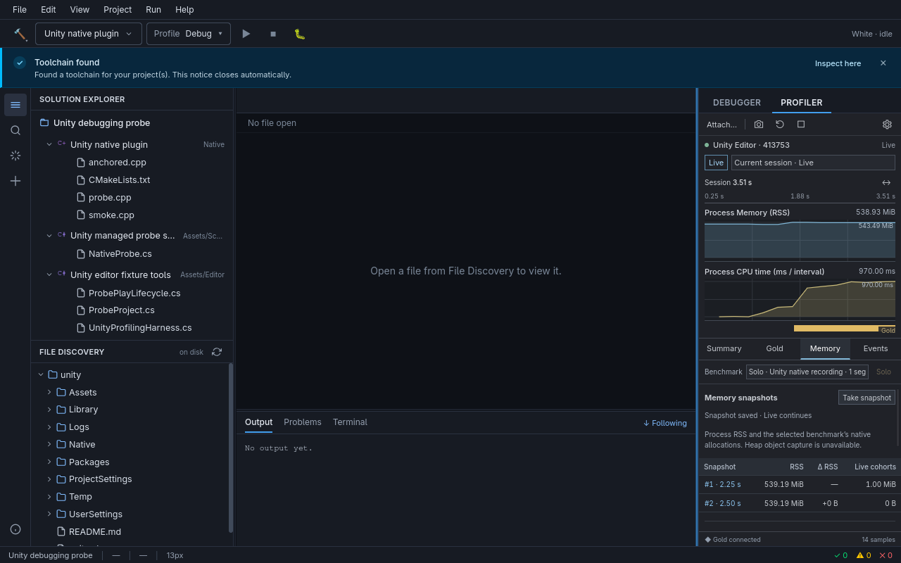
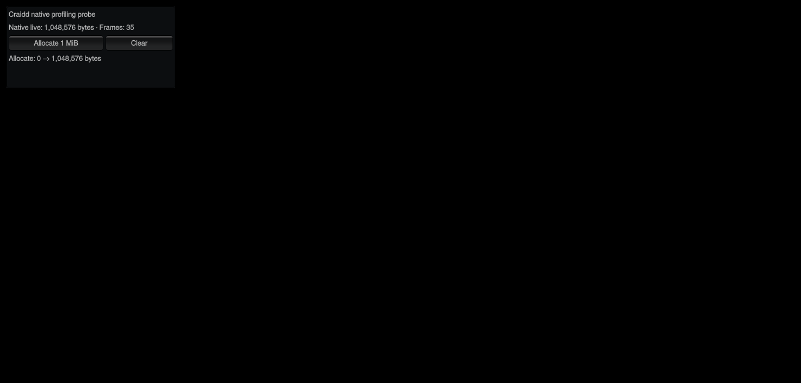

# Unity profiling repair and runtime report

**Roadmap track:** Phase 3.x / 3.5, native Unity attach and profiling.

**Status:** Native fixture repairs and scoped runtime qualification, 17 October
2026. Continuation of `d00d19d` on `feat/unity/profiling-a-to-p`.
The [checklist](../../uiux/unity-profiling-harness-checklist.md) retains unproved
clauses; this is not a public release or Unity managed-debugging qualification.

## Outcome and evidence boundary

The compact Profiler now has visible SVG controls, automatic recovered Solo
segments, fair bounded hit history, pinned live cohorts, separate retention and
coverage counters, durable Play generations and snapshots that keep Live
selected. A diagnostic Game-view overlay provides Allocate/Clear, native live
bytes and a frame counter. The tested native path is useful for development:
Unity first → explicit Profile only → Play → retained allocation → snapshot →
clear → compare → next Play, without restarting or reattaching the Editor.

The user supplied an independent **Claude Opus 5.5** review. That is received
review evidence, including the old uncapped disconnect and the session-specific
silent menu failure. This continuation was implemented and tested by **Codex**;
no new Claude invocation or review response is claimed. The
[initial findings](unity-profiling-uiux-report.md) retain the original user
screenshots and observations. Automated assertions, runtime measurements and
source-only conclusions are identified below.

Every Unity execution used a disposable `/tmp/cui-*` copy of tracked fixture
sources, a freshly built plugin and its own signal directory. No command,
attachment, click, restart, signal or build targeted the user's live Editor.
The original workspace plugin was not rebuilt. The initially untracked
`workspaces/unity/ProjectSettings/PackageManagerSettings.asset` is preserved
and excluded from every commit. Its SHA-256 remains
`622993c5611db4016b72dbf12de4754a642fa96b071d2fd663cc40253db5764e`.

## Findings, repairs and remaining issues

| Finding | Before / reproduction | Repair and evidence | Commit |
| --- | --- | --- | --- |
| F01 / U02 · high | Embedded style policy blocks dynamic style elements; toolbar codicons stay blank. User screenshot and supplied review; new embedded run records `style-src-elem` violations with Monaco open. | Four inline SVG controls render as 16×16 paths with nontransparent stroke, no icon font, cold/no file and with Monaco open. Embedded and development URL tested. | `2d6df9d` |
| F02/F04 / U10 · high | User's live menu click produced no log and 0 native bytes. Fresh Editor copies work; the live failure is session-specific, not diagnosed by modifying that session. | Game overlay makes actions/readouts visible. Real Unity menu dispatch returns success, native counter is 0 → 1,048,576 → 0 and action logs correlate with Craidd. Inspector repaint and physical overlay-button clicks remain untested. | `2d6df9d`, `b68993a` |
| U16 · high | Disconnect closes Solo but leaves its state set; subsequent events never reopen it. | Reset pending Solo on disconnect; unique fresh segment on reconnect. Keep interrupted cohort ownership so later frees update the original result. Real forced disconnect/reconnect, retained 1 MiB and late free pass. | `33cd819` |
| U17 · high | Hot `unity.native.mix` takes nearly all capture slots; closed Solo/live cohorts can disappear. | Pin Solo/open/live-cohort captures; retain 128 ordinary completed hits per marker and fair global eviction. Real uncapped rolling history and late free pass. Global 2,000-slot/all-pinned edge has Rust regression proof. | `33cd819`, `b68993a` |
| F03 / U17 · medium | `dropped` combines ordinary sample aging, eviction and source failures. | Events separates aged samples, evicted captures, rejected events, source gaps and disconnects. Footer distinguishes Rolling history from Coverage interrupted. Old `dropped` remains compatibility data for source rejections/gaps only. | `33cd819`, `d363ec7` |
| U14 · high | One lossy Play-end event can strand a session. | Generation plus playing/idle state in every native event and periodic heartbeat; sequence gaps close incomplete intervals and permit fresh Solo. Repeated real Play increments batch/generation; unit test deliberately omits Play end. | `e7dc7e0` |
| U04/U12 · medium | Saving a snapshot freezes the selected view with no obvious return. | Save keeps Live; reviewing a snapshot is explicit; visible Live button returns. Eight-view eviction returns a missing selected snapshot to Live. Real snapshot comparison and store regression pass. | `d363ec7`, `310f546` |
| U17 · high | Nonblocking send failure disconnects source; collector reads `/proc` for every event and serializes a full profile while locked. | Preserve connection on fully unsent EAGAIN/EINTR, sequence loss honestly; batch reads/parse outside lock; check target identity periodically; sample process counters and publish outside lock; copy only public view data. Long uncapped runtime has zero source rejections/gaps/disconnects. | `e7dc7e0` |
| U00/U16 · high | Discovery ignores HOME/XDG and stale artifacts survive host death. | Private runtime/HOME fallback with scoped namespace and PID birth identity; scoped lock, atomic route ownership, normal-exit cleanup and dead-owner cleanup by provider/next host. Real harness host SIGKILL removes route/socket and replacement reconnects to the same disposable Editor. | `e7dc7e0` |
| F06 / U03 · low | Synthetic narrow Summary has 3 px horizontal overflow. | Flexible section title and compact view controls. Actual Tauri Summary/Memory width matrix and keyboard focus recorded. | `d363ec7` |
| U15 · high, found during repairs | At 2,000 pinned slots, Record again could close the current Solo before admission failed. | Reserve first; on failure retain current batch/open Solo and show storage-full reason. Reproduced failing test, then passing regression. Heartbeats retain existing marker warnings. | `b68993a`, `310f546` |
| F05 / U00 · high | Real harness exists only on another branch. | Import applicable files from `uiux/ui-harness` at `280b1d8`, without merging unrelated branch work; separate synthetic fixture from real Tauri/Unity evidence. Add scoped process proof and native WebDriver port isolation. | `64674d4` |

Relevant production sources are
[`ProfilerPanel.tsx`](../../../src/components/panels/ProfilerPanel.tsx),
[`profilingStore.ts`](../../../src/store/profilingStore.ts),
[`profiling.rs`](../../../src-tauri/src/commands/profiling.rs),
[`profiling_discovery.rs`](../../../src-tauri/src/commands/profiling_discovery.rs),
[`craidd_gold.hpp`](../../../support/profiling/craidd_gold.hpp),
[`NativeProbe.cs`](../../../workspaces/unity/Assets/Scripts/NativeProbe.cs),
[`ProbePlayLifecycle.cs`](../../../workspaces/unity/Assets/Editor/ProbePlayLifecycle.cs)
and [`probe.cpp`](../../../workspaces/unity/Native/probe.cpp).

### CSP decision remains pending

`src-tauri/tauri.conf.json` is unchanged from `d00d19d`. SVG fixes only these
Profiler controls; Monaco syntax/icon/runtime styles remain blocked in the
embedded app. The [CSP proposal](../../uiux/proposal-monaco-csp-styles.md)
explains the selective `dangerousDisableAssetCspModification: ["style-src"]`
option, its inline-CSS/UI-spoofing trade-off and the stricter nonce-propagation
alternative. **Neither option was applied. User approval is required.**
Do not infer that this repairs debugger hover or all editor styles.

### General IDE baseline remains red

The imported original scenarios were run separately: **2 pass, 2 fail**.
Title registration and app-specific Exit pass. Explorer edge placement fails:
a README menu at a 900×600 viewport has bounds left 897, top 597, right 1117,
bottom 832.86. The C# debugger case times out waiting for hover value (empty
text); its earlier breakpoint/Watch steps execute. Reproduction commands are
below; evidence remains in the local run directories. See [menu evidence](assets/remaining-explorer-edge.png),
[hover evidence](assets/remaining-debugger-hover.png),
[menu scenario](../../../tests/ui/menus.test.mjs) and
[debug scenario](../../../tests/ui/debug.test.mjs). These are medium-severity
usability failures: expected an in-viewport menu and a visible local value;
actual bounds/value are recorded above. No root cause or fix is claimed here
for either remaining general IDE issue. These are separate from
the targeted native profiling flow and prevent an all-IDE green claim.

## Runtime environment and reproducibility

Unity version: **6000.5.10f1**, Linux Editor from the installed Unity Hub tree.
The batch cases run a resident Editor with `-batchmode -nographics`, without
`-quit`; a copied Editor script polls file signals and invokes
`EditorApplication.ExecuteMenuItem` for actual native menu actions. The overlay
case uses a separate graphical Editor and captures the actual Game view.
No mocked allocation or synthesized profile events substitute for Unity.
Each driver has its own process group; deliberately dead driver sessions are
retired before replacement launch. No foreign Unity target is in that group.
The controller disables periodic allocation during exact memory comparisons.

Craidd is the embedded debug Tauri application built by `test:ui:build`, using
production frontend/backend code through `tauri-driver` and WebKitWebDriver.
The final build includes product `310f546`; harness foundation is `64674d4`
with synchronization correction `98f16aa` and dead-driver cleanup `eaf6851`.
No product code changes follow that build. Source/plugin hashes, process start
identities, viewport and measured panel widths are retained in the portable
[measurement record](assets/repair-measurements.json) and
[screenshot manifest](assets/repair-evidence-manifest.json). Run manifests
record copied sources and a plugin SHA, proving a fresh copy/build rather than
a claim about the binary in the user's original Editor.

At the normal desktop scale the webview is **1280×800, devicePixelRatio 1**.
The width matrix records outer requested widths 288/360/420, actual content
width and scrollWidth independently. Screenshots contain web content; they do
not prove shell decorations or other monitors. Process identities in the
measurement record belong to historical exited copies, never reusable PIDs.

The development icon binary overrides only `build.devUrl` to a private
`http://127.0.0.1:5198/` Vite server. Its record confirms that URL, and the
server was stopped after the run. The embedded application was rebuilt after
this experiment; it is the current default harness binary. CSP was never
relaxed in either case.

## Measurements and commands

Commands run from the repository root (logs under
`/tmp/craidd-unity-repair-20261016/`, local artifacts under ignored
`test-results/ui/<timestamp>/`). The portable record identifies exact runs;
raw Unity logs and scratch HOME contents are intentionally not committed.

| Final disposable run | PID / Linux start identity | Fresh plugin SHA-256 prefix |
| --- | --- | --- |
| 60 fps | 413753 / 4061112 | `cbb950e69a8ae27d` |
| Uncapped | 416266 / 4063835 | `46b42e6ed3bd76e1` |
| Recovery | 418795 / 4066202 | Full plugin hash in measurement record |

The measured panel content widths are 287/359/419 px inside the respective
288/360/420 px outer panels; scrollWidth equals clientWidth in Summary and
Memory at each size. The final embedded binary SHA-256 is
`ac3cd25e87e8611fffcfc58988d7324849b2e78f678f50cf19b3ce2637284800`.

```sh
npm run test:ui:build
npm run test:ui:profiling
CRAIDD_TEST_UNITY=1 CRAIDD_TEST_LONG=1 node --test --test-name-pattern='uncapped fps' tests/ui/unity-profiling.test.mjs
CRAIDD_TEST_UNITY=1 node --test --test-name-pattern='60 fps' tests/ui/unity-profiling.test.mjs
CRAIDD_PROFILE_NAMESPACE=repair-qualified-unit cargo test --offline --manifest-path src-tauri/Cargo.toml --lib
node --test tests/*.test.mjs
npx tsc --noEmit
node --test --test-concurrency=1 tests/ui/titles.test.mjs tests/ui/menus.test.mjs tests/ui/debug.test.mjs tests/ui/exit.test.mjs
```

Development-webview experiment (no committed configuration change):

```sh
TAURI_CONFIG='{"build":{"devUrl":"http://127.0.0.1:5198"}}' cargo build --offline --manifest-path src-tauri/Cargo.toml
cp src-tauri/target/debug/craidd-studio /tmp/craidd-unity-repair-20261016/bin/dev-craidd-studio
npm run dev -- --host 127.0.0.1 --port 5198 --strictPort
CRAIDD_UI_APP=/tmp/craidd-unity-repair-20261016/bin/dev-craidd-studio node --test tests/ui/profiler-icons.test.mjs
# Stop only that private server, then restore the embedded application:
npm run test:ui:build
```

| Verification | Result / practical limit |
| --- | --- |
| Rust library | 172 pass, 5 ignored, 0 fail. Includes native sockets, discovery security/isolation, missed generation/sequence events, fairness, pinned capacity, late frees and shutdown. Ignored manual desktop tests are not promoted to passes. |
| Frontend regressions | 14 test files pass, 0 fail; includes immutable Live snapshots and selected-snapshot eviction. TypeScript passes. |
| Embedded build | Pass; unchanged CSP. Existing build warnings do not constitute runtime qualification. |
| Real targeted suite | **5 pass / 0 fail**, final combined `npm run test:ui:profiling`, 93.83 s, harness `eaf6851`. Includes rendered thread/batch inspection and sequential dead-driver cleanup. |
| Development icon case | Pass: cold/no file and Monaco open at actual private development URL. A registration-timeout attempt is retained; clean rerun passes. |
| Long uncapped Unity | Pass, about 630 s total. At the rolling-history checkpoint: 2,400 samples retained, 1 aged sample, 9,957,822 capture evictions, 9,955,374 frames, 0 source gaps, 0 rejected events, 0 disconnects. Allocate/free, another Play/batch and Stop continue afterwards. |
| General original UI cases | 2 pass / 2 fail, as described above. |

The long run used an intermediate working-tree build, before the final warning,
snapshot-eviction, all-pinned edge and forced-disconnect/cleanup corrections.
It demonstrates the intermediate transport/retention implementation; it is not
represented as a ten-minute run on the final commit. The final short runs cover
the resulting build and new regression checks. A final-build ten-minute rerun remains an explicit
optional replication command: `npm run test:ui:profiling:long`.

Earlier failed harness attempts are retained: conflicting native-driver port
was fixed by per-launch native ports; a snapshot assertion initially read
backend state before the frontend rendered the free; a later worker select
had the same publication timing issue. The final scenario waits for rendered
values/options. A resize-pointer attempt failed; the helper now reuses the
single mouse source, records pointer coordinates and pauses at pointer down.
No layout pass is inferred from the failed attempt. A later combined run had
a fresh-copy Unity Bee compiler-pipe error before controller readiness, and a
replacement-driver timeout after its allocation succeeded. The recovery test
now closes the dead driver process group before launching its replacement; a
scoped rerun passes and exits. The Bee startup failure is retained as an
environment limitation; no compiler-source fix is claimed.

## Visual evidence

Original blank controls, from the user's session:



Embedded cold/no-file controls after repair:



Compact Summary and Memory at the narrow width:





Actual graphical disposable Game view, showing the diagnostic overlay:



Additional evidence: [editor open](assets/after-profiler-editor-open.png),
[retained cohort](assets/after-profiler-retained.png),
[immutable comparison after clear](assets/after-profiler-cleared.png),
[expanded hit](assets/after-profiler-recorded-hit.png),
[420 px memory](assets/after-memory-420px.png),
[thread/batch inspection](assets/after-profiler-thread-filter.png),
[collector scope labels](assets/after-profiler-coverage.png),
[long rolling history](assets/after-profiler-rolling.png),
[source reconnect](assets/after-profiler-reconnected.png) and
[replacement host](assets/after-profiler-replacement.png).
These are unedited copies; hashes and source paths are in the manifest.

## Checklist result and remaining limits

**Checklist: 16 passed, 4 partial/unrun, 0 fully failed, 0 blocked.** The
master gate remains unchecked. The checklist's result table is authoritative
for U00–U19. Partial clauses
stay unchecked; the master gate remains open until those are proved. Native
fixture success does not qualify managed C# Gold, Unity Mono/IL2CPP attach,
LDI reproduction/ABI, GPU, hardware cycles, full heap objects/retention paths,
GC tracing, allocation stacks or arbitrary plugin unload/reload.

Capture retention is bounded: 128 ordinary hits per marker, 2,000 captures
including pins, 2,400 process samples, 20,000 tracked allocations and eight
saved views. Saturating all capture slots with pins reports capacity failure;
it cannot retain unbounded history. Record again leaves the current recording
intact at that limit. Cohort sums are inclusive: do not sum Solo and nested
ranges as unique heap usage. RSS can stay high after an observed native free.
Default 60 fps is useful for interactive fixture testing; uncapped mode is a
stress case, not a promise of zero loss at arbitrary producer rates. Sequence
gaps and transport interruption remain observable rather than hidden.

The user's original silent menu session was not touched or diagnosed further.
Physical pointer testing of overlay buttons, Inspector repaint, a dedicated
ranges-only/no-Solo runtime and every stale/ambiguous Editor dialog state
remain separate acceptance gaps. A standalone Disconnected label/readability
check is also open; recovery and interrupted-coverage accounting are proved.
The two general IDE failures and Monaco's CSP decision remain visible follow-ups.

## Short user test

1. Save your Unity work when convenient. To load the new native provider,
   close the Editor/player using this project, then build the plugin from the
   repository root and reopen the project:

   ```sh
   cmake -S workspaces/unity/Native -B workspaces/unity/Native/build -DCMAKE_BUILD_TYPE=Debug
   cmake --build workspaces/unity/Native/build -j2
   ```

   This report did not run those commands against your original project or
   restart your Editor. The source overlay recompiles normally, but a loaded
   old native plugin cannot be replaced safely without your chosen reload.
2. Start the rebuilt Craidd, open the Unity solution, choose Run → Attach to
   Process → the matching Editor → Profile only. No socket environment setup
   is needed for the rebuilt prepared provider.
3. Enter Play. In the Game view use Allocate 1 MiB. Expect native live bytes
   1,048,576 and the Solo cohort to show 1.00 MiB. Save a snapshot; Live stays
   selected. Clear; expect 0 B live. Save another snapshot, select the earlier
   one to compare, then use Live to return.
4. Stop Play: expect Ready for Play. Play again: expect a new batch/Solo
   segment without another Attach. Stop profiling leaves Unity running.

---

*Last updated: Phase 3.x / 3.5, 17 October 2026. Author: ShinkuKira21.*
*This document is a record.*
