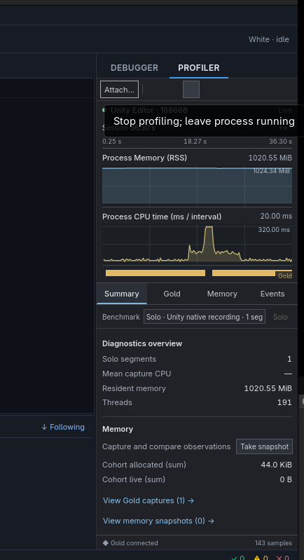
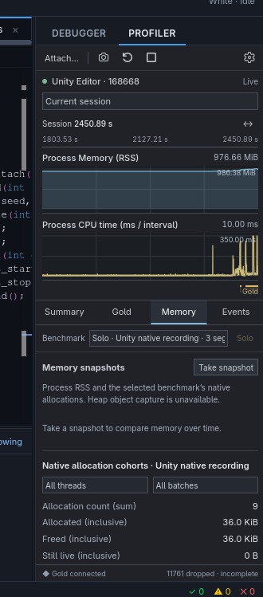
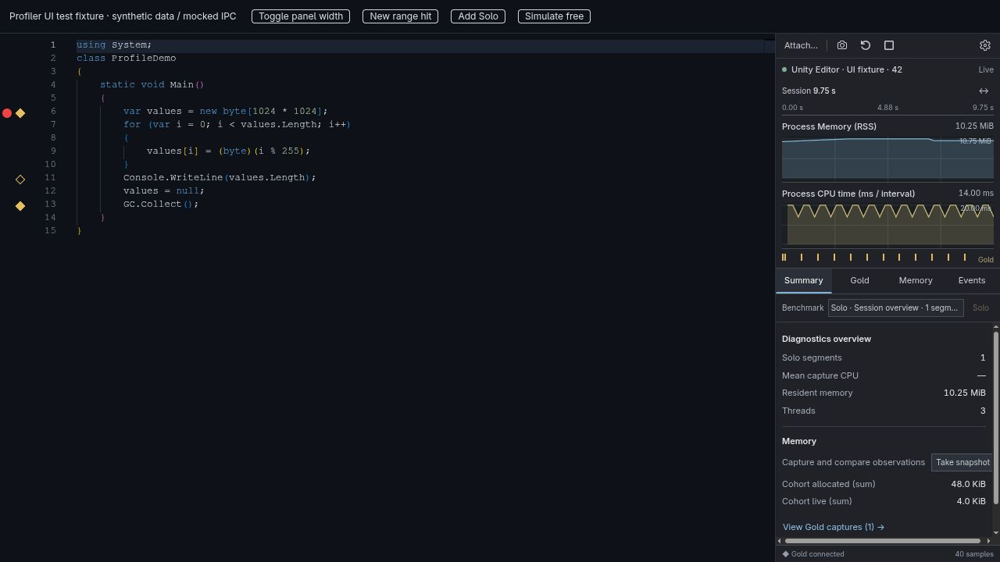

# Unity profiling UI/UX — initial findings

**Roadmap track:** Phase 3.x / 3.5, native attach and profiling usability.

**Status:** Initial local findings, 16 October 2026. Implementation acceptance
remains open. This is not an Opus review; the requested external review has
not run because the available Claude Code session is logged out.

**Scope:** `feat/unity/profiling-a-to-p` at `af2af04`, Unity 6000.5.10f1 on
Linux. Evidence combines user desktop screenshots, reported interaction,
source/assembly inspection, and a labelled browser fixture. No completed real
desktop UI/UX harness run exists for this profiling slice.

## Findings

| ID | Severity / status | Finding and evidence | Required next proof |
| --- | --- | --- | --- |
| F01 / U02 | High · open | User desktop screenshot shows blank Snapshot, Record again, Stop and Settings controls. Hovering Stop exposes its tooltip but not a visible glyph. `ProfilerPanel.tsx` renders empty spans with `codicon` classes; the app does not explicitly own/import these styles for the Profiler. | Diagnose actual Tauri style/font/asset/CSP behavior and cold-start/editor-open differences; verify visible graphics/text in the real build. |
| F02 / U10–U12 | High · open | User explicitly confirmed clicking the enabled Unity top-menu allocation action produced no Console message. Native Live Bytes remained 0, and the earlier live Craidd Solo showed 36 KiB allocated/freed and 0 B live. | Trace callback execution and direct native counter in the running Editor, then correlate the allocation/free source events with the selected Craidd cohort and immutable snapshots. Root cause is unconfirmed. |
| F03 / U17 | Medium · open | User screenshot shows 11,761 dropped/incomplete. `profiling.rs` increments `dropped` when the sample ring ages out, when completed captures are evicted, and on source errors/disconnects. The display cannot distinguish normal history retention from lost measurement. | Separate retention/coverage counters and show an understandable bounded-history state. Verify sustained Play and allocation/free after the limits. |
| F04 / U04, U10 | Medium · partly instrumented, unqualified | The testing route depended on a hidden component menu and writable observation field; it took several exchanges to locate. `af2af04` adds top-menu actions, immediate native field refresh and before/after/cleanup logs, but the user still reports no response. | Demonstrate the visible action and feedback through Unity itself. Avoid requiring hidden menus, guessing field semantics or repeated instructions without evidence. |
| F05 / U00 | High · open | This branch has a synthetic browser fixture; the real Tauri harness is only present in another checkout at `280b1d8`. Its historic passes do not cover this branch's Profiler. | Integrate the harness and add a real Unity profiling scenario with revision-specific artifacts. |
| F06 / U03 | Low · open | In the narrow browser fixture, the panel measures 287 px and the Summary results have `clientWidth=277`, `scrollWidth=280`, producing a horizontal scrollbar. This is synthetic layout evidence only. | Remove unintended horizontal overflow while retaining readable labels and reachable controls; repeat the width matrix in Tauri. |

The screenshot establishes F01's desktop symptom. A browser check of
`tests/ui/profiling.html` at its 288 px panel width renders all four codicon
glyphs: computed pseudo-content exists and the font family is `codicon`.
Monaco brings styles into that fixture. Therefore the initial suggestion that
there is simply no icon stylesheet anywhere was too broad; the desktop cause
is not yet proven. This difference is a required regression case.

## Preserved evidence

User desktop, blank toolbar controls:

User desktop, no retained cohort and mixed dropped/incomplete counter:

Browser-only synthetic fixture, icons do render; this is not a Unity/Tauri
runtime pass:

## What has been verified

- Unity Editor PID 168668 targeted this repository's `workspaces/unity` and
  mapped the updated native plugin without a deleted-file suffix during the
  inspected session. PID is an observation, not a reusable test identifier.
- The user's desktop previously showed Gold connected, an active Solo and
  4 KiB allocated/freed with 0 B live. This proves some prepared source events
  reached the UI; it does not prove the retained 1 MiB action.
- Loading the same plugin in a separate native process and calling its
  allocate/live/clear exports gives 0 → 1,048,576 → 0 bytes. It does not exercise
  the Unity menu or the user's collector session.
- Updated runtime and Editor scripts compile against installed Unity references.
  Current `Library/ScriptAssemblies` outputs were newer than the source edits
  and contain the diagnostic/menu strings. The inspected Editor log contains
  successful reloads but no `[Craidd Probe]` action entry or relevant C# error.
  These facts narrow investigation; they do not prove a callback was invoked.
- At `dd7447b`, the Rust suite passed 161 tests with five ignored, and the live
  Editor/worker discovery test passed separately. Those are earlier scoped
  results, not a fresh UI/UX acceptance run.

## Handback state

The [Unity checklist](../../uiux/unity-profiling-harness-checklist.md) contains
U00–U19. All remain unchecked pending complete evidence for their stated scope;
partial observations above are not promoted to end-to-end passes. Blocking
areas are toolbar rendering, the silent retained-allocation action, and the
missing branch-local real-app harness. The master usability checkbox is open.

Requested reviewer/model: Opus 5.5. Actual external review: **not run**.
The [handoff](../../handoffs/handoff-unity-profiling-uiux-2026-10-16.md) defines
the implementation, verification and final report expected from that review.

---

*Last updated: Phase 3.x / 3.5, 16 October 2026. Author(s): ShinkuKira21.*
*This document is a record.*
