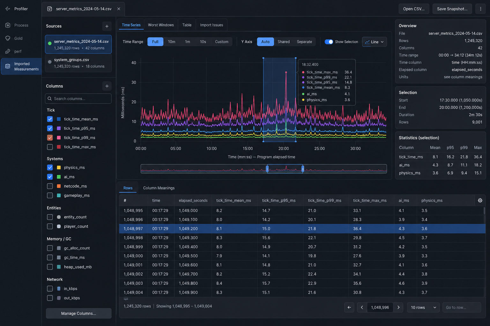

# Imported metric inspection in the Profiling editor

**Roadmap track:** Phase 3.5 profiling.
**Status:** Proposed design, 22 October 2026. The supplied image is a candidate direction, not approved implementation or public-release acceptance. UI work remains on hold.
**Scope:** GR-001 imported CSV inspection in the existing **Profiling** editor tab. Standard process/Gold profiling retains its existing sidebar and editor hosts. GR-002 capture controls and trees require their own reviewed surface.
**Companions:** [Source contract](design-profile-source-contract.md), [workspace hosts](design-profiler-workspace-modes.md), [scopes](design-profiler-scopes.md), [GR-001 decisions](revisions/implementation-decisions.md), [human acceptance](revisions/gr-001-m1-human-acceptance.md).

## Candidate and assessment

This direction addresses the current inspection problem: the chart is the main
surface; searchable series controls sit beside it; a brush and overview support
range selection; rows and details explain the selection. Setup, parser settings
and provenance no longer consume the first screen. It is a credible direction
for a public-release interface, subject to the semantics and acceptance below.
A static image establishes neither working interactions nor accessibility,
performance, recovery or human usability.

The image's example numbers, statistical labels, selection states and source
names are illustrative. They are not fixture data or instructions. In particular,
the depicted mean/p95/p99 table cannot become run-level statistics derived from
per-window percentile columns. A hidden series shown in a tooltip must be
labelled hidden, and the selected table row must agree with the active range.

## Host and layout

Use the existing typed **Profiling** tab inside Craidd's normal editor area.
Keep the IDE menus, source tabs, status bar and ordinary lower panels. The image
is not a replacement application shell. Do not add a second outer navigation
rail or render imported analysis in the IDE sidebar. Sources/series inside the
editor are inspection controls, not a new IDE sidebar.

Keep one Profiling tab per window, with the imported source/file name shown
inside it. Choosing a CSV source does not create an editable CSV document or
another collector. Source tabs remain available. Returning to code restores
normal sidebar behaviour; returning to Profiling restores inspection state.

| Region | Purpose | Proposed behaviour |
| --- | --- | --- |
| Compact toolbar | Open CSV, open snapshot, save snapshot, source status | Primary actions stay visible; paths/settings/provenance go in named disclosures |
| Sources and series pane | Choose a file set, group and visible numeric columns | Search, checkbox, colour and literal name/unit; selected time column is not plotted as a metric by default |
| Main analysis | Chart, explicit axes, brush, overview | Largest area; chart and row selection work directly without entering a row number |
| Details | Source overview, selected row/window, descriptive summaries | Readable aligned label/value pairs; collapsible inspector at narrower widths |
| Lower inspection | Rows, largest values, import issues, column meanings | One virtualized table with deliberate view changes; selectable/resizable dock |

At wide editor widths, show source pane, chart and inspector together. At
narrower widths, collapse the inspector into a labelled drawer and allow the
source pane to collapse; retain a usable chart before adding more axes. At low
editor heights, let the table become a switchable view or collapsed dock. Do not
force chart plus table plus inspector into tiny unreadable regions. Initial
proposed verification sizes are ordinary 1280×800 and 1920×1080 IDE windows,
the existing 900-pixel minimum window width, and 125%/150% text scaling. These
are layout tests, not approved fixed pane dimensions.

## Chart semantics

- Every axis names its domain and unit. With no time interpretation, use
  **Retained row ordinal**, never elapsed seconds. Disable time-duration presets
  until the file has a valid time axis. File time is not session time; keep
  clocks separate until an explicit M3 mapping exists.
- Row spacing alone never supplies window duration. Draw declared windows as
  steps/bands with their actual boundaries. Unknown duration stays visible as
  unknown. Gauges/unknown values can use points; any connecting line is an
  explicit display choice and does not imply a measured window or bridge gaps.
- Keep mixed units in separate labelled tracks by default. A shared axis is
  available for compatible declared units; no implicit normalization, arbitrary
  dual axes or unit conversion. “Auto” must explain the actual selected scale.
- Preserve extrema when reducing data for display. Make point/selection marks
  visible and provide exact row values on inspection. A reduced bucket is not
  an original row or a new statistical aggregate.
- Do not stack or total columns by default. Nesting/overlap remains unknown
  unless the user explicitly declares exclusive columns. Budgets/thresholds are
  user-set values saved with source interpretation, never invented defaults.
- Colour supplements labels, checkboxes and focus/selection shapes. A tooltip
  lists units and distinguishes visible series from other row attributes.

## One inspection state

The selected source set/group, visible series, viewport, brush range, selected
row and inspection view form one per-editor state. Hover is transient and
visually distinct from the committed row selection. Selecting a chart point or
table row highlights the same original row and updates details; selecting a
range filters rows and descriptive summaries. A committed row outside a newly
selected range is cleared or explicitly brought into view, never silently
shown as if it were inside. Keyboard navigation and direct range entry provide
alternatives to dragging.

Companion rows join only under a saved named-key exact/toleranced rule. Details
show unjoined and ambiguous rows plainly; source grouping never pairs rows by
position or establishes clock alignment. All numeric and text cells remain
available in row details, including unplotted columns and empty cells.

The ranking view says **Largest values** when a value has no known window, and
**Worst windows** only for declared windows. Name the ranked column and unit;
choosing an entry selects that original row/window. It asserts neither a cause
nor a performance verdict.

Selection statistics are **Median / Q1–Q3 / Maximum of retained row values**,
with value count, missing count and the original column name/unit. For a
per-window p99 column, label the result as a distribution of per-window p99
values. It is not the p99 of the selection/run. Do not average percentiles,
combine nested columns, infer counter deltas/rates or time-weight unknown
windows. No domain-specific grouping is assumed from a column name; optional
manual groups and other convenience features remain proposed.

## Integrity, settings and persistence

An empty view offers Open CSV and Open snapshot. Loading shows measured byte
progress and Cancel while retaining an interactive IDE. A partial import shows
a concise count/status near the source; Import issues contains line/record,
kind and bounded diagnostic detail. Do not hide rejected records behind a
green source dot. File provenance and hashes belong in inspectable details.

Interpretation edits name the time column, units, meaning, declared window
duration and join rules. Preview their effect and commit or cancel atomically.
Existing immutable snapshots never change. Snapshots reopen without producer
files, and state their retained range/omissions. Switching source/code tabs
preserves inspection; window close cancels owned loading and never touches the
producer. File sets remain per import; sidecars, live follow, project defaults,
cross-session alignment and comparison are not added by this visual proposal.

## Acceptance before public release

| Gate | Required evidence |
| --- | --- |
| Semantics | Ordinal/time/unknown-duration/mixed-unit fixtures; no percentile re-aggregation or positional joins |
| Direct inspection | Point → row → details and row → chart; brush/ranking linked; hover and selection distinct |
| Desktop layout | Ordinary display at the stated sizes/scales; chart readable above the fold; source/inspector/dock collapse without clipped controls |
| Accessibility | Keyboard import/series/range/row/ranking flow, visible focus, names/units, adequate contrast and no colour-only status |
| Loaded scale | Existing million-row fixture and incremental-memory gate; release-build interaction p95 <100 ms, with per-operation distributions |
| Recovery | Cancel/import issues/missing file and owner close; immutable snapshot reopen; producer unchanged |
| Human usability | User can find a spike, inspect original and companion data, explain axes/units/coverage and reopen the inspection unaided |

Report PASS / FAIL / PARTIAL / BLOCKED / NOT TESTED separately. An automated
click path or attractive screenshot does not pass the human gate. Before code,
review the final host, responsive layout, statistical labels and interaction
states with the user. GR-002's accepted backend checkpoint approves no UI.

---

*Last updated: 22 October 2026. Author(s): ShinkuKira21.*
*This document is a design.*
