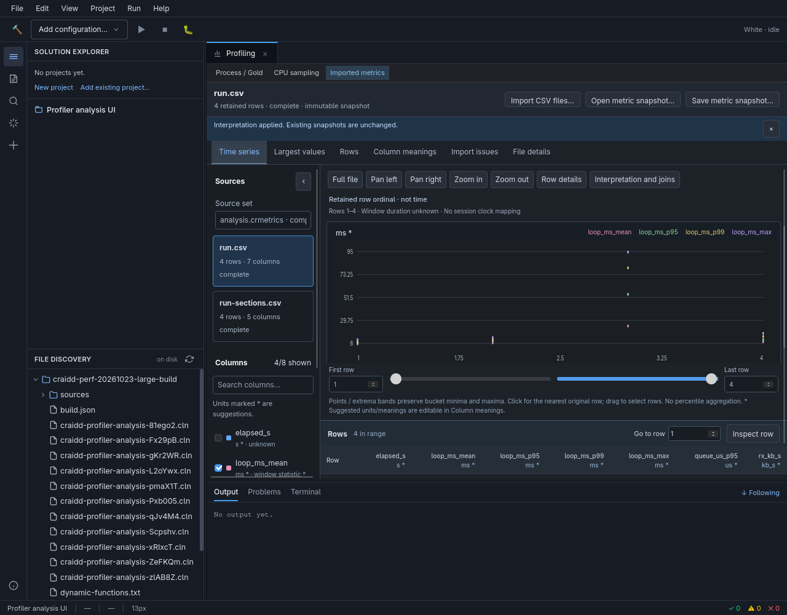
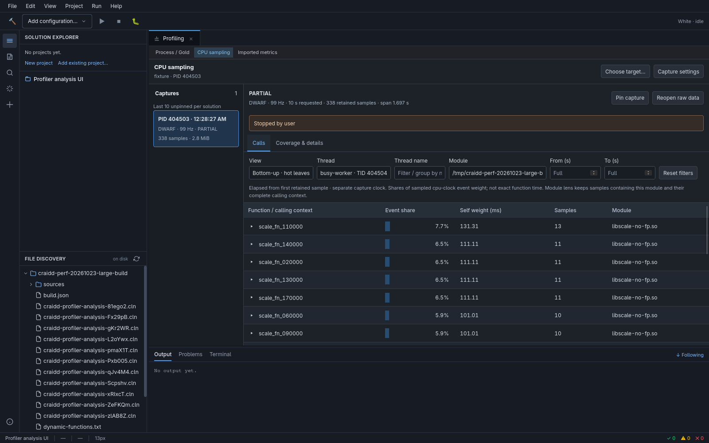

# Profiler analysis UI: implementation and verification

**Roadmap track:** Phase 3.5 profiling.
**Status:** Local implementation; human acceptance and public-release performance remain open.
**Branch:** `codex/profiling-profiler-ui`, based on perf `464e407` plus M1 fix `3059ea1` cherry-picked as `ad656c7`. Existing M1 and perf branches are retained. Nothing pushed or merged.
**Machine:** sk27; Linux 7.2.11-arch1-1; ordinary Wayland session through XWayland and separate Xvfb runs; perf 7.2.11-1; embedded debug desktop build. Binary SHA-256, target incarnations, captured options, coverage and viewport dimensions are recorded in the evidence JSON.
**Design:** [analysis interface](../design-profiler-analysis-ui.md), [metric candidate](../design-metric-inspection-editor.md).

[Ordinary desktop evidence](../../../../workspaces/profiling-metrics/evidence-2026-10-23-profiler-ui-ordinary.json), [Xvfb evidence](../../../../workspaces/profiling-metrics/evidence-2026-10-23-profiler-ui-xvfb.json).

## Delivered

**CPU sampling** is available in the normal Profiler sidebar and Profiling editor. It selects a target using the existing Profile only flow; reviews frequency/interval, duration, explicit FP/DWARF and stack size, estimated raw cost and coverage; starts/stops captures; displays collection versus decoding state; and retains the result's own clock and actual sample span. A capture history exposes pinning and raw reopening. Bounded lazy top-down/bottom-up trees share thread/TID, thread-name, exact-module and elapsed-range filters. Resolved source opens through the backend identity/solution guard. Unresolved module/address frames and map-origin labels are preserved. Coverage exposes both loss report types separately, scan completion, omissions, gained threads, module/debug identity diagnostics, output size and PARTIAL reasons.

**Imported metrics** now places source cards and searchable column checkboxes beside a multi-series chart. Compatible units share a scale; mixed units get separate labelled tracks, with up to eight plotted columns. Setup, integrity, ranking and provenance have dedicated views. Row clicks and chart point selection inspect original rows and declared companions; drag and row-range controls change the viewport. The lower table uses bounded 50-row pages. Long text previews are explicitly marked and bounded in native IPC; row inspection still supplies complete original cells. Unit/meaning suggestions, bulk interpretation, elapsed ranking keys, immutable snapshots and per-file inspection state remain intact. Changed join rules refresh inspected companion data.

The supplied candidate's miniature chart overview, advanced pointer handles, resizable dock and descriptive selection-summary cards remain proposed. The delivered slice uses explicit row-range sliders/inputs and bounded pages. There is no live follow, comparison, implicit clock mapping, percentile averaging, stacked section total or new collector. Flight recording remains excluded.

## Gates

| Gate | Result | Evidence / scope |
| --- | --- | --- |
| TypeScript / production frontend bundle / embedded debug build | PASS | Final build recorded with desktop binary hash; existing bundle-size warning remains |
| Metric native parser/interpretation/page/point selection | PASS | 20 fixture tests, including irregular time, page bounds, Unicode preview bounds, original-cell preservation and immutable snapshots |
| Window-scoped metric commands | PASS | 4 native tests |
| Perf model/lifecycle regressions | PASS | 20 native tests; positive loss parser fixture included |
| Frontend presentation / row keys / profiling workspace | PASS | Loading with null native summary, FP warnings, existing profiling/typed-tab suites |
| Ordinary desktop metrics | PASS | Actual window IPC and controls: import, suggestions, bulk units/meaning, elapsed ranking, original/companion row, direct chart selection, immutable snapshot reopen |
| Ordinary desktop perf | PASS | Actual Profile only target, cost review, DWARF 99 Hz capture, manual Stop, known native hot leaves, thread/module filters, expanded top/down tree, verified source, pin, raw reopen |
| Safe Stop and owning-window close | PASS | Target PID/start time remains alive; separate FP 999 Hz capture closed with its owner; output retains the close reason and is reopened from raw data in a new solution window |
| Xvfb desktop workflows | PASS | Same metric and timed-perf workflows, recorded separately |
| Responsive editor layout | PASS | 900 / 1280 / 1600 window widths at the harness's normal scale; no whole-panel horizontal overflow; chart above fold; imported CSV absent from sidebar |
| Current desktop loss values | PASS | Completed loss scan; actual LOST/LOST_SAMPLES counts in JSON (zero in these captures); positive-loss UI injection not performed |
| Native chooser / screen reader / 125% and 150% desktop scaling | NOT TESTED | Harness imports by its explicit path controls; no human/accessibility certification inferred |
| Million-row release p95 / incremental memory on this layout | NOT TESTED | Prior M1 results are historical evidence; this redesign does not inherit a new performance PASS |
| Human/public-release usability | NOT TESTED | [M1 checklist](gr-001-m1-human-acceptance.md), [perf checklist](gr-002-perf-ui-human-acceptance.md) |

The first native test exposed a real null-summary rendering crash before decode. It was fixed and covered by a presentation regression. The raw-reopen view distinguishes an initial no-samples completion note from the subsequently decoded sample count. Source navigation also exposed setup visibility resetting on remount; perf presentation now survives navigation. Test-only selector mistakes were corrected separately, without treating failed harness runs as product evidence. All passing desktop captures and target identities are in the final JSON; stopped captures remain PARTIAL with their reason.

[GR-003/004 review and fixture gates](gr-003-gr-004-qualification.md) are independent proposed follow-ups. GR-003 mechanism qualification does not imply production settings or reopen integration. GR-004's raw-leaf naming pass does not override its existing full-stack naming FAIL.

---

*Last updated: 24 October 2026. Author(s): ShinkuKira21.*
*This document is a record.*
